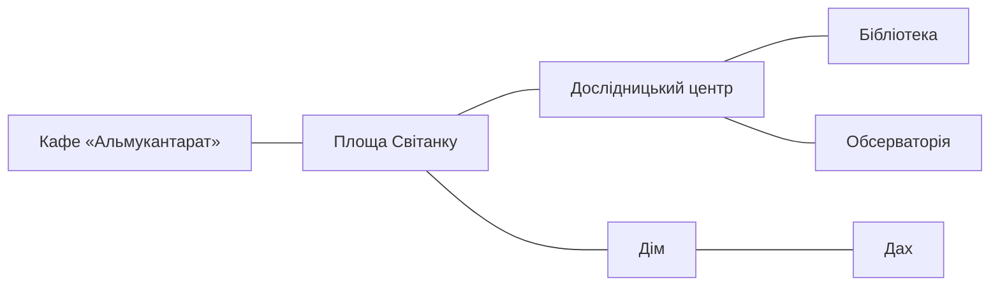
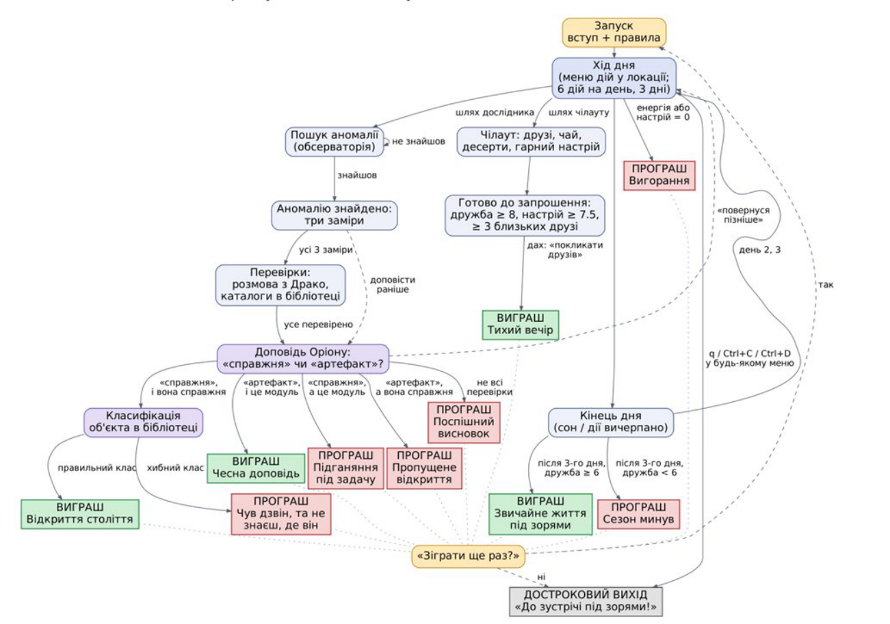
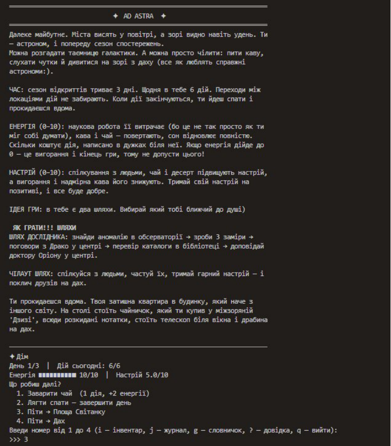
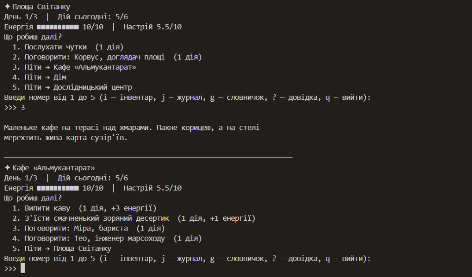
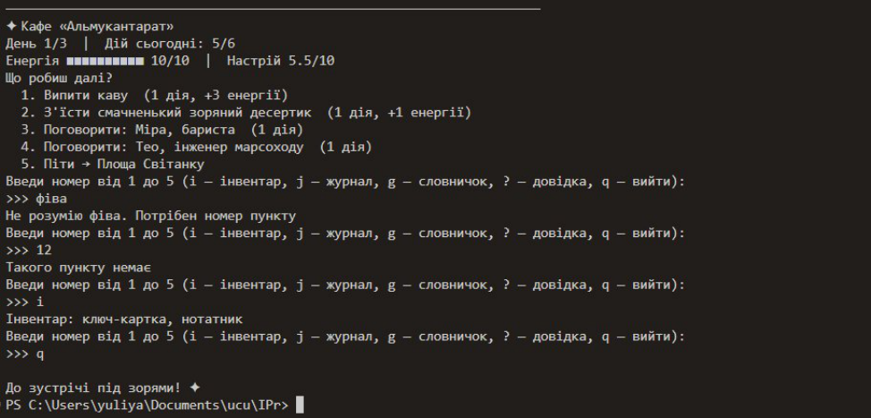
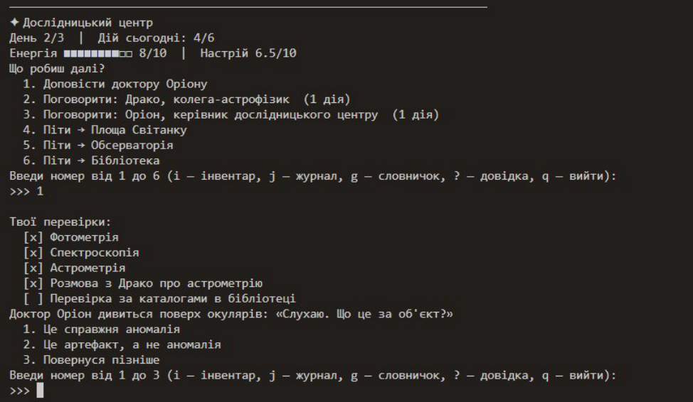
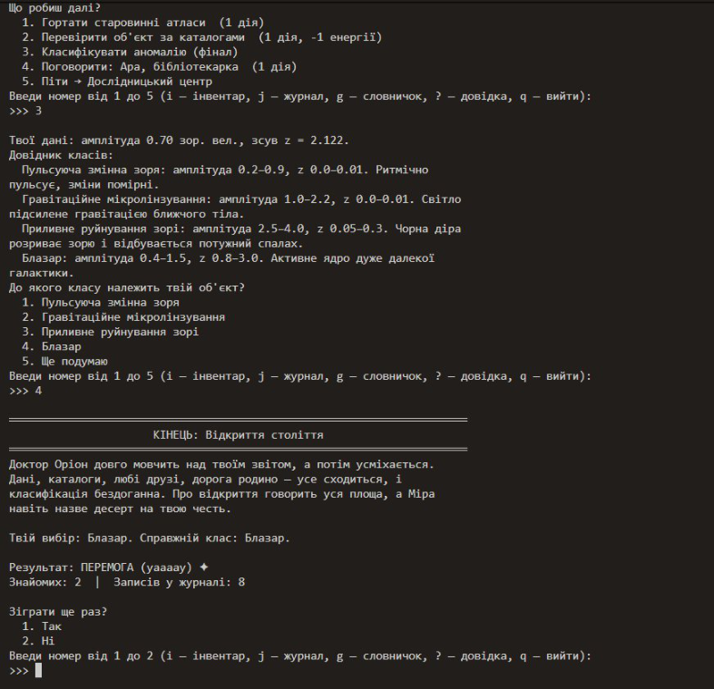

# Ad Astra

**Звіт**

## Опис гри

### Сеттінг

Дія відбувається в далекому майбутньому, у місті, яке висить у повітрі: житлові квартали пливуть над хмарами, між ними літають ракети, а зорі видно навіть удень. Головний герой — молодий астроном, до якого гра звертається на «ти». Він живе в затишній квартирі з телескопом біля вікна та драбиною на дах, а попереду в нього короткий сезон спостережень — усього три дні. Світ складається із семи локацій (карта нижче).

Центр міста — Площа Світанку з доглядачем Корвусом, від неї можна піти додому, у кафе «Альмукантарат» (бариста Міра та інженер марсоходу Тео) або в скляний Дослідницький центр із гігантським механічним орерієм. У центрі працюють колега-астрофізик Драко та суворий керівник доктор Оріон; звідти ведуть двері до Обсерваторії з головним телескопом міста і до Бібліотеки, де бібліотекарка Ара береже атласи й каталоги неба від XVII століття.

### Сюжет / ідея

Гра починається з того, що герой прокидається вдома в перший день сезону. На площі ходять чутки, що у сузір'ї Ліри третю ніч щось дивно мерехтить, а над північним кварталом нещодавно повісили житловий модуль «Лелека-3», який уночі блищить, як зоря. Звідси й головний конфлікт: у телескоп обсерваторії можна побачити загадковий об'єкт, але ніхто не знає, чи це справжнє космічне явище, чи просто відблиск модуля. Гравець мусить не повірити першому враженню, а зібрати докази і встигнути це зробити, поки не скінчився сезон і не вичерпалися власні сили (бо вигорати це погана ідея).

Водночас гра не змушує ставати науковцем, бо я розумію що багато кому це не цікаво. Другий шлях — чілаут, тобто просто жити в цьому місті, пити каву з корицею, частувати знайомих десертиком «Зірочка палай» і врешті покликати друзів на дах дивитися на Чумацький Шлях. Тож закінчитися гра може великим відкриттям, чесним визнанням помилки, тихим вечором у колі друзів, або поразкою: поспішним висновком, пропущеним відкриттям, вигоранням чи порожнім сезоном. Усього кінцівок десять: 4 переможні й 6 програшних, плюс достроковий вихід.

### Сценарій

Кожен хід виглядає однаково. Гравець бачить назву локації, рядок стану (день 1–3, скільки з шести дій лишилося сьогодні, смужку енергії 0–10 і настрій 0–10) та нумероване меню. Меню залежить від місця і від прогресу: заміри з'являються лише тоді, коли аномалію знайдено, а пункт «Класифікувати» — коли її визнав Оріон. Гравець вводить номер пункту. Перехід між локаціями безкоштовний, а будь-яка інша дія забирає одну з шести щоденних дій і змінює енергію: кава дає +3, чай +2, десерт +1, пошук і кожен замір забирають по 2, перевірка в каталозі — 1. Коли дії скінчилися (або герой ліг спати), день завершується і наступний починається вдома з повною енергією.

У будь-якому меню можна ввести службову команду, яка не витрачає ходу:

| Команда | Дія |
|---|---|
| `i` | інвентар |
| `s` | стан |
| `j` | журнал знахідок |
| `g` | словничок термінів |
| `?` | правила |
| `q` | вийти |

Шлях дослідника — це певний ланцюжок кроків:

1. Пошук в обсерваторії (якщо невдало, шанс наступної спроби зростає, а друга спроба вже гарантовано щось знаходить; чутки, атлас і погляд із даху теж підвищують шанс).
2. Три заміри: фотометрія (амплітуда блиску), спектроскопія (червоний зсув z) й астрометрія (зсув на небі за годину).
3. Розмова з Драко, який пояснює астрометрію: великий зсув означає щось близьке, як-от модуль.
4. Перевірка в каталогах бібліотеки.
5. Доповідь Оріону з вибором «справжня аномалія» чи «артефакт».
6. Для справжньої — вибір класу з довідника за двома числами.

Головні рішення гравця по факту це який шлях обрати, коли відпочити, чи ризикнути енергією після попередження гри, кого пригостити тістечком, що сказати Оріону і до якого класу віднести об'єкт.

*Схема гри: стани (сині), точки рішень (фіолетові), виграші (зелені), програші (червоні), вихід (сірий). Пунктир — повернення назад («повернуся пізніше», новий день, нова партія). Об'єкт виявляється справжнім приблизно в 65 % партій, тож обидві відповіді Оріону мають сенс і всі чотири гілки доповіді реально трапляються; після будь-якої кінцівки гра пропонує зіграти ще раз.*

### Кінцівки

| Кінцівка | Тип | Як до неї дійти |
|---|---|---|
| Відкриття століття | 🟢 виграш | Об'єкт справжній, усі перевірки зроблено, сказано «справжня», клас обрано правильно. |
| Чесна доповідь | 🟢 виграш | Усі перевірки зроблено, об'єкт виявився модулем «Лелека-3», сказано «артефакт». |
| Тихий вечір | 🟢 виграш | Сумарна дружба ≥ 8, настрій ≥ 7,5, щонайменше 3 друзі з рівнем ≥ 2. Тоді на даху з'являється пункт «Покликати друзів». |
| Звичайне життя під зорями | 🟢 виграш | Три дні минули без фіналу, але сумарна дружба ≥ 6. |
| Чув дзвін, та не знаєш, де він | 🔴 програш | Аномалію визнано, але в бібліотеці обрано не той клас. |
| Підганяння під задачу | 🔴 програш | Усе перевірено, об'єкт виявився модулем, а гравець каже «справжня». |
| Пропущене відкриття | 🔴 програш | Усе перевірено, об'єкт справжній, а гравець каже «артефакт». |
| Поспішний висновок | 🔴 програш | Будь-яка відповідь Оріону, поки не виконано всі п'ять перевірок. |
| Вигорання | 🔴 програш | Енергія падає до 0 (гравець погодився на дію після попередження) або настрій падає до 0 (наприклад, від надміру кави). |
| Сезон минув | 🔴 програш | Три дні минули без фіналу, сумарна дружба < 6. |
| Достроковий вихід | ⚪ вихід | `q`, Ctrl+C або Ctrl+D у будь-якому меню. Гра прощається: «До зустрічі під зорями!». |

## Запуск і приклади

Гра запускається, потрібен термінал з UTF-8. Нижче приклади з одного запуску, що закінчився відкриттям, і з окремого запуску для некоректного вводу.

**Початок гри:** заставка, вступ про місто в повітрі, правила (тут частину правил пропущено, щоб кадр був компактнішим) і перший хід у локації «Дім». Гравець обирає пункт 3 — іде на площу.

**Перехід між локаціями.** Гравець стоїть на Площі Світанку: перший день, лишилося 5 дій із 6, енергія повна, настрій 5,5. Він обирає пункт 3 і йде в кафе «Альмукантарат». Кафе відвідується вперше, тому гра показує його повний опис: тераса над хмарами, запах кориці, жива карта сузір'їв на стелі. Далі з'являється нове меню з діями, які є тільки тут: кава (+3 енергії), зоряний десерт (+1 енергії) і розмови з баристою Мірою та інженером Тео. Лічильник дій не змінився (5/6), бо перехід між локаціями не витрачає часу.

**Некоректний ввід і достроковий вихід.** У кафе гравець вводить текст («фіва») і номер, якого немає в меню («12»). Гра не падає: вона пояснює, що не так, і знову показує запрошення до вводу. Команда `i` показує інвентар, не забираючи дію, а `q` завершує гру достроково з прощальним повідомленням.

**Доповідь Оріону з незавершеними перевірками.** На другий день гравець приходить до Оріона, зробивши всі три заміри й поговоривши з Драко, але не перевіривши об'єкт за каталогами. Гра показує чек-лист із п'яти пунктів, де бракує одного. Оріон питає, що це за об'єкт. Будь-яка відповідь, крім «Повернуся пізніше», зараз призведе до кінцівки «Поспішний висновок», тому розумний вибір — спершу піти в бібліотеку.

**Класифікація і кінцівка «Відкриття століття».** У бібліотеці гравець бачить свої дані (амплітуда 0,70, z = 2,122) і довідник класів. За амплітудою об'єкт підходить і до пульсуючої зорі, і до блазара, але великий червоний зсув вказує лише на блазар. Гравець обирає правильний клас і отримує переможну кінцівку. Гра показує обраний і справжній клас, результат ПЕРЕМОГА та підсумкову статистику, а потім пропонує зіграти ще раз.

## Процес розробки

Спочатку я сіла за ідею гри, бо насправді ідея це одна з найголовніших частин будь-якої роботи. Я до УКУ займалася олімпіадною астрономією і я її дуже люблю) Тому я хотіла зробити якусь гру, яка зможе спробувати показати людям яке це життя астронома. Потім через деякий час я поспілкувалася зі своїми однокрильчанами і вони сказали, що все якось дуже важко, тому я вирішила додати ще одну чілаут гілку, щоб всі, навіть ті хто не дуже хоче розбиратися в астрономії могли гарно провести час. Імена всіх персонажів я старалася брати з назв сузір'їв, бо як я вже згадувала люблю астрономію. Але для мене особливий Драко, бо це моє улюблене сузір'я)

Написати код було насправді великим викликом, бо дуже багато гілок, персонажів і взагалі коду, тому доволі важко не втратити нитку думки, тим більше, коли ти пишеш це не один день і коли дійшов до кінця, то вже забув початок. Також вставляти спеціальні символи це було так собі, бо доволі незручно копіювати.

Під час тестування виявилося, що люди не хочуть читати великий текст і постійно забувають, що взагалі потрібно зробити, тому треба було зробити чіткіші інструкції. Також виявилося, що люди не розуміють деяких термінів, тому я їх винесла в окремий словничок.

Але я просто щаслива, що можу поділитися своєю любов'ю до астрономії)

## Структура проєкту

### Файли

Проєкт складається з одного файлу гри `syvak_game.py` і цього звіту. Внизу наведений список констант.

| Дані | Що в них і як їх використовує гра |
|---|---|
| `SETTINGS` | Налаштування: кількість днів і дій, максимум енергії й дружби, слово виходу, службові команди, набір обов'язкових замірів і шаблони їхніх повідомлень. Копіюється у стан як `cfg`. |
| `WORLD` | Сім локацій: назва, опис, сусідні локації (виходи) і якість неба. З виходів будуються пункти «Піти →». |
| `NPCS` | Шість персонажів: де стоять, хто вони, і по чотири репліки. Що вища дружба, то тепліша репліка. |
| `RUMORS` | П'ять чуток із позначкою, чи це підказка про аномалію. Перемішуються на старті й видаються по одній на площі. |
| `ANOMALIES_CLASSES` | Чотири класи аномалій: назва, опис і діапазони амплітуди та червоного зсуву. Потрібні для генерації об'єкта і для довідника при класифікації. |
| `ENDINGS` | Десять кінцівок: назва, текст і чи це перемога. Показуються функцією фіналу. |
| `GLOSSARY` | Словничок незнайомих слів, що виводиться за командою `g`. |

### Функції

| Функція | Група | Що робить | Звідки викликається |
|---|---|---|---|
| `say` | Інтерфейс | Друкує текст, переносячи рядки по 70 символів. | Майже з усіх функцій, що виводять повідомлення |
| `read_input` | Інтерфейс | Зчитує рядок, прибирає пробіли й регістр. На «q», Ctrl+C чи Ctrl+D повертає «нічого», тобто сигнал виходу. | `ask_choice` |
| `ask_choice` | Інтерфейс | Показує нумероване меню й чекає коректний номер. Службові команди виконує на місці, на помилки відповідає поясненням. | `game_loop`, `main`, `talk`, `tired_ok`, `report`, `classify` |
| `run_command` | Інтерфейс | Виконує службову команду: інвентар, стан, журнал (останні 8 записів), довідку чи словничок. | `ask_choice` |
| `show_help` | Інтерфейс | Виводить правила: час, енергію, настрій і два шляхи гри. | `intro`, `run_command` |
| `show_status` | Інтерфейс | Друкує день, залишок дій, смужку енергії та настрій. | `game_loop` (щоходу), `run_command` |
| `intro` | Інтерфейс | Показує заставку, вступ і правила на початку партії. | `main` |
| `show_ending` | Інтерфейс | Друкує кінцівку. Для класифікації показує правильний клас, для чілауту — список друзів, наприкінці — результат ПЕРЕМОГА/ПОРАЗКА. | `main` |
| `main` | Керування грою | Запускає партії одну за одною, поки гравець хоче грати знову. | Останній рядок файлу |
| `new_game` | Керування грою | Створює словник стану нової партії зі стартовими значеннями. | `main` |
| `game_loop` | Керування грою | Головний цикл: стан → меню → дія. Закінчується, коли є кінцівка або вихід, і перевіряє вигорання за настроєм. | `main` |
| `build_actions` | Керування грою | Складає список доступних дій для поточної локації з урахуванням прогресу. | `game_loop` |
| `do_action` | Керування грою | За ключем обраного пункту викликає потрібну функцію дії. | `game_loop` |
| `spend` | Час, енергія, стосунки | Змінює енергію і забирає одну дію. При енергії 0 настає вигорання, при 0 дій — кінець дня. | Усі дії, що витрачають хід |
| `end_day` | Час, енергія, стосунки | Переводить на новий день і відновлює сили. Після третього дня визначає кінцівку сезону. | `spend`, `sleep` |
| `tired_ok` | Час, енергія, стосунки | Попереджає, якщо дія доведе до вигорання, і питає, чи все одно її робити. | `survey`, `measure`, `check_catalog` |
| `change_mood` | Час, енергія, стосунки | Змінює настрій, тримаючи його в межах 0–10. | Дії з людьми, їжею, напоями, зорями, атласом |
| `add_journal` | Час, енергія, стосунки | Додає в журнал запис із номером дня. | Чутки, розмова з Драко, зорі, пошук, заміри, каталог, доповідь |
| `total_bonds` | Час, енергія, стосунки | Рахує суму дружби з усіма персонажами. | `end_day`, `chill_ready` |
| `close_friends` | Час, енергія, стосунки | Повертає множину персонажів із дружбою ≥ 2. | `chill_ready`, `show_ending` |
| `chill_ready` | Час, енергія, стосунки | Перевіряє умови для запрошення друзів на дах. | `build_actions`, `watch_stars` |
| `move` | Повсякденні дії | Переносить героя в іншу локацію. При першому відвідуванні показує повний опис. | `do_action` |
| `listen_rumors` | Повсякденні дії | Видає наступну чутку. Підказки збільшують шанс знайти аномалію. | `do_action` |
| `talk` | Повсякденні дії | Розмова з персонажем: репліка за рівнем дружби, +1 до дружби, можливість пригостити тістечком. Драко коментує астрометрію. | `do_action` |
| `drink_coffee` | Повсякденні дії | Дає +3 енергії. Третя і кожна наступна кава за день псує настрій. | `do_action` |
| `eat_dessert` | Повсякденні дії | Дає +1 енергії, піднімає настрій і дає тістечко з собою для пригощання. | `do_action` |
| `brew_tea` | Повсякденні дії | Дає +2 енергії і трохи настрою вдома. | `do_action` |
| `watch_stars` | Повсякденні дії | Сцена на даху. Настрій залежить від якості неба, може з'явитися підказка про Ліру. | `do_action` |
| `sleep` | Повсякденні дії | Завершує день достроково. | `do_action` |
| `invite_friends` | Повсякденні дії | Встановлює кінцівку «Тихий вечір». | `do_action` |
| `create_anomaly` | Наукова механіка | Випадково створює об'єкт: справжній (65 %) певного класу або артефакт, з координатами та «істинними» значеннями. | `survey` |
| `survey` | Наукова механіка | Пошук в обсерваторії. Шанс росте з підказками та спробами. | `do_action` |
| `measure` | Наукова механіка | Робить один замір із невеликим шумом і каже, яких ще бракує. | `do_action` |
| `read_atlas` | Наукова механіка | Атлас у бібліотеці піднімає настрій, а вперше дає зоряну карту й підказку. | `do_action` |
| `check_catalog` | Наукова механіка | Шукає об'єкт у каталогах (лише після трьох замірів). Результат: «нічого не знайдено» або збіг із «Лелекою-3». | `do_action` |
| `report` | Наукова механіка | Показує чек-лист перевірок, приймає вердикт і визначає кінцівку або відкриває класифікацію. | `do_action` |
| `classify` | Наукова механіка | Показує дані й довідник класів, приймає вибір і ставить кінцівку відкриття або помилки. | `do_action` |

### Як ми тримаємо стан гри

| Ключ | Тип | Що зберігає |
|---|---|---|
| `cfg` | `dict` | Копія налаштувань. У ній `required` — `set` обов'язкових замірів, `measure_order` — `tuple` з порядком замірів у меню, `commands` — `dict` службових команд. |
| `world`, `npcs` | `dict` | Локації та персонажі. Виходи локацій — `tuple`, репліки персонажів — `list`. |
| `classes` | `tuple` | Класи аномалій. Кожен клас — `tuple` з назвою, описом і двома `tuple`-діапазонами. |
| `endings` | `dict` | Ключ кінцівки → `tuple` (назва, текст, чи перемога). |
| `season` | `range` | Дні сезону 1–3. Сезон закінчується, коли номер дня виходить за ці межі. |
| `inventory` | `list` | Речі героя: ключ-картка, нотатник, а пізніше зоряна карта й тістечко. |
| `journal` | `list` | Записи про знахідки у форматі «День N: …». |
| `visited` | `set` | Відвідані локації, щоб повний опис показувати лише першого разу. |
| `met` | `set` | Імена персонажів, з якими герой говорив. |
| `bonds` | `dict` | Ім'я персонажа → рівень дружби 0–5. |
| `rumors` | `list` | Перемішані чутки, кожна — `tuple` (текст, чи підказка). Беруться з кінця. |
| `anomaly` | `dict` / `None` | Знайдений об'єкт: чи справжній, координати (`tuple`), номер класу та `dict` «істинних» значень. |
| `measurements` | `dict` | Вид заміру → отримане значення. Різниця з `required` дає список того, чого бракує. |
| Решта ключів | числа, рядки, `bool` | День, залишок дій, енергія, настрій, поточна локація, лічильники підказок, спроб і кави, прапорці перевірок, вердикт, обраний клас, кінцівка й прапорець виходу. |
| список дій (тимчасовий) | `list` | Існує лише один хід: `list` із `tuple` (текст пункту, ключ дії, аргумент) від `build_actions`. З нього `game_loop` будує меню, а `do_action` дізнається, що виконати. |
